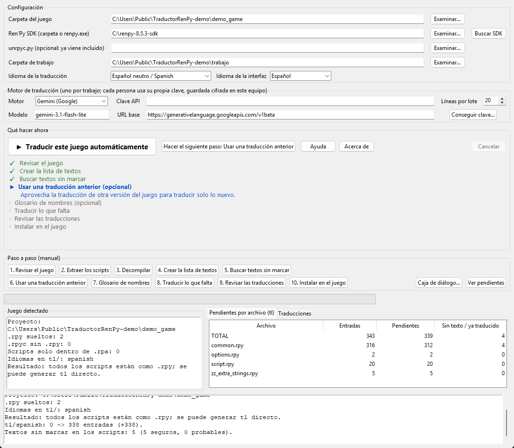

# TraductorRenPy

**Traduce novelas visuales de Ren'Py a tu idioma con un solo botón.**
*(English version: [README.md](README.md))*



TraductorRenPy toma un juego de Ren'Py, encuentra cada línea de texto (diálogos, menús, botones, avisos…), la
traduce con el motor de IA que elijas, comprueba que no se rompa nada del juego y vuelve a instalar la traducción,
guardando un respaldo de todo lo que escribe.

## Características

- **Modo de un botón**: «Traducir este juego automáticamente» hace todos los pasos y solo pregunta lo necesario.
- **Lista guía**: muestra qué está hecho (✓), qué sigue (▶) y recuerda dónde ibas entre sesiones.
- **Motores**: Gemini (con nivel gratuito), Grok (xAI) y Microsoft Translator. Cada persona usa **su propia clave de API**.
- **Contexto de escena**: el modelo ve las líneas vecinas y quién habla, más un glosario por juego (los nombres de
  personajes se conservan; el título del juego nunca se traduce).
- **Seguro por diseño**: cada línea traducida se valida (etiquetas `{i}`, variables `[name]`, `%s`, `\n`, comillas)
  antes de escribirse; los ids y comentarios nunca cambian; se hace respaldo antes de escribir.
- **Aprovecha trabajo previo**: importa la traducción de una versión anterior (o un parche de otra persona) y
  traduce solo lo nuevo o cambiado.
- **Encuentra textos sin marcar**: avisos de `renpy.input`, `text`/`textbutton` en pantallas, notificaciones…
  que Ren'Py no extrae solo.
- **Funciona con archivos `.rpa`**: extrae solo los scripts (sin tocar el juego) y decompila `.rpyc` con
  [unrpyc](https://github.com/CensoredUsername/unrpyc) (incluido, MIT).
- **8 idiomas destino** (español, portugués, francés, alemán, italiano, ruso, polaco, turco); se puede escribir
  cualquier otro nombre de idioma de Ren'Py. Interfaz en **español e inglés**.
- **Las claves se guardan cifradas** en tu equipo (DPAPI de Windows), nunca dentro del proyecto.

## Inicio rápido (Windows)

1. Descarga el último `TraductorRenPy-…-windows.zip` de la página **Releases** y descomprímelo.
2. Instala el **Ren'Py SDK**, gratis: <https://www.renpy.org/latest.html> (la app lo encuentra sola, o usa el
   botón *Buscar SDK*).
3. Consigue una clave de API: el botón *Conseguir clave…* abre la página correcta. Gemini tiene nivel gratuito.
4. Abre `TraductorRenPy.exe`, elige la carpeta del juego, el idioma y el motor, pega tu clave y pulsa
   **▶ Traducir este juego automáticamente**.
5. Abre el juego: arranca en el idioma elegido.

> Windows SmartScreen o tu antivirus pueden avisar sobre el `.exe` porque no está firmado digitalmente (es común
> en herramientas pequeñas hechas con PyInstaller).

## Cómo funciona

```
analizar → (extraer .rpa → decompilar .rpyc) → generar tl con el Ren'Py SDK → buscar textos sin marcar
         → usar traducción anterior (opcional) → traducir con el motor → validar → instalar
```

## Qué toca en tu juego

- Escribe la traducción en `game/tl/<idioma>/` y crea `game/zz_<idioma>.rpy`.
- Los respaldos van a la carpeta de trabajo (`respaldos`). Para deshacer, copia el respaldo de vuelta sobre
  `game/tl/<idioma>`.
- Los scripts del juego **nunca se modifican**. Los ajustes estéticos opcionales (caja de diálogo) están en un
  archivo aparte, `game/zz_ui_tweaks.rpy`, que puedes borrar cuando quieras.

## Límites conocidos

- El texto **dibujado dentro de imágenes** (carteles, fondos con letras) no se puede traducir; solo el texto que el
  juego escribe como texto.
- La calidad depende del motor elegido; una traducción automática siempre merece una lectura.
- Probado en Windows 11 con Python 3.14 y Ren'Py SDK 8.5.3. Gemini se probó con una clave real; **Grok y Microsoft
  Translator están implementados y probados solo con servidores de prueba**: se agradecen reportes.
- Linux/macOS: el código es portable pero no está probado (el cifrado de claves es solo de Windows; en otros
  sistemas las claves se guardan en texto plano en la configuración del usuario).

## Uso responsable

Traduce solo juegos que tengas derecho a traducir. Algunos desarrolladores no permiten decompilar ni redistribuir
traducciones: respétalo. **No compartas los scripts extraídos ni las traducciones de juegos ajenos sin permiso de
sus autores**, y no subas contenido de ningún juego a este repositorio. Este proyecto no incluye archivos de
juegos, ni claves de API, ni el Ren'Py SDK.

## Preguntas frecuentes

**¿Cuesta dinero?** La app es gratis. Los motores de traducción los cobra cada proveedor; Gemini tiene nivel
gratuito. Antes de gastar tu cuota, la app te dice cuántos textos faltan y pide confirmación.

**¿Mi clave está segura?** Se guarda cifrada para tu usuario de Windows y solo se envía al proveedor que elegiste.
No compartas tu `settings.json` ni pegues tu clave en público.

**¿Puedo parar y seguir después?** Sí. Las traducciones se guardan en caché por juego y la guía recuerda cada paso.

**El juego aún muestra algo en inglés.** El texto dentro de imágenes, o el que el juego arma con variables, no se
puede alcanzar. Vuelve a ejecutar *Buscar textos sin marcar* y abre un *issue* con un ejemplo (sin contenido adulto).

## Opiniones y errores

¿Encontraste un error o tienes una idea? Abre un [issue](https://github.com/TraductorRenPy/TraductorRenPy/issues) o escribe en [Discussions](https://github.com/TraductorRenPy/TraductorRenPy/discussions). Nunca adjuntes archivos de juegos, traducciones de otras personas ni claves de API: bastan unas líneas del registro y un ejemplo inventado corto.

## Apoyar el proyecto

Si esta herramienta te ahorró tiempo y quieres ayudarme a seguir mejorándola, puedes donar aquí:
[☕ ko-fi.com/traductorrenpy](https://ko-fi.com/traductorrenpy)

## Créditos y licencia

Uso gratuito, todos los derechos reservados: ver [LICENSE](LICENSE). El código fuente no es público. Usa [unrpyc](https://github.com/CensoredUsername/unrpyc) (MIT, incluido) y el
SDK de [Ren'Py](https://www.renpy.org/) (no incluido). Ver [THIRD_PARTY_NOTICES.md](THIRD_PARTY_NOTICES.md).
