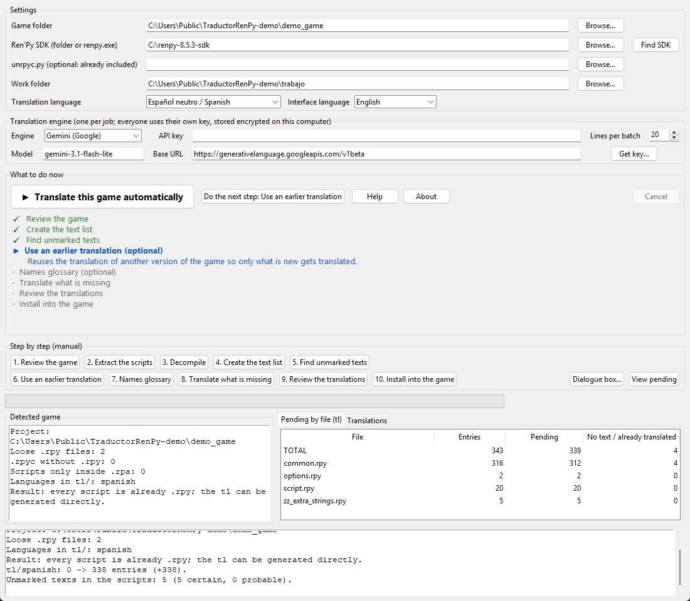

# TraductorRenPy

**Translate Ren'Py visual novels into your language, with one button.**
*(Versión en español: [README.es.md](README.es.md))*



TraductorRenPy takes a Ren'Py game, finds every line of text (dialogue, menus, buttons, notices…), translates
it with the AI engine of your choice, checks that nothing in the game can break, and installs the translation
back into the game — keeping a backup of everything it writes.

## Features

- **One-button mode** — "Translate this game automatically" runs every step and only asks what it must.
- **Guide list** — shows what is done (✓), what is next (▶), and remembers where you were between sessions.
- **Engines** — Gemini (has a free tier), Grok (xAI) and Microsoft Translator. Everyone uses **their own API key**.
- **Scene context** — the model sees the neighbouring lines and who is speaking, plus a per-game glossary
  (character names are kept; the game's title is never translated).
- **Safe by design** — every translated line is validated (tags `{i}`, variables `[name]`, `%s`, `\n`,
  quotes) before it is written; ids and comments never change; backups are made before writing.
- **Reuses earlier work** — import the translation of an older version (or a patch made by someone else) and
  translate only what is new or changed.
- **Finds unmarked texts** — `renpy.input` prompts, `text`/`textbutton` in screens, notifications… which Ren'Py
  does not extract by itself.
- **Works with `.rpa` archives** — extracts only scripts (without touching the game) and decompiles `.rpyc`
  with [unrpyc](https://github.com/CensoredUsername/unrpyc) (bundled, MIT).
- **8 target languages** built in (Spanish, Portuguese, French, German, Italian, Russian, Polish, Turkish);
  any other Ren'Py language name can be typed in. Interface in **English and Spanish**.
- **API keys are stored encrypted** on your computer (Windows DPAPI), never inside the project.

## Quick start (Windows)

1. Download the latest `TraductorRenPy-…-windows.zip` from the **Releases** page and unzip it.
2. Install the free **Ren'Py SDK** from <https://www.renpy.org/latest.html> (the app finds it by itself, or use
   the *Find SDK* button).
3. Get an API key — the *Get key…* button opens the right page. Gemini has a free tier.
4. Run `TraductorRenPy.exe`, choose the game folder, choose the language and engine, paste your key and press
   **▶ Translate this game automatically**.
5. Open the game: it starts in the chosen language.

> Windows SmartScreen or your antivirus may warn about the `.exe` because it is not code-signed (this is common
> for small open-source tools built with PyInstaller). The full source is in this repository, and you can run it
> from source instead (see below).

Want to try it first? Use the included [`examples/demo_game`](examples/demo_game) (harmless original text).

### Run from source

Requires Python 3.9+ (Tk included in the standard installer). No extra packages are needed.

```bash
python main.py
```

## How it works

```
analyze → (extract .rpa → decompile .rpyc) → generate tl with the Ren'Py SDK → find unmarked texts
        → reuse earlier translation (optional) → translate with the engine → validate → install
```

Details for contributors: [docs/ARCHITECTURE.md](docs/ARCHITECTURE.md).

## What it touches in your game

- It writes the translation into `game/tl/<language>/` and creates `game/zz_<language>.rpy`.
- Backups go to the work folder (`respaldos`). To undo, copy the backup back over `game/tl/<language>`.
- The game's own scripts are **never modified**. Optional cosmetic tweaks (dialogue box) live in a separate
  file, `game/zz_ui_tweaks.rpy`, that you can delete at any time.

## Known limitations

- Text **drawn inside images** (signs, backgrounds with letters) cannot be translated; only text the game writes
  as text.
- Quality depends on the engine you choose; machine translation always deserves a read-through.
- Tested on Windows 11 with Python 3.14 and Ren'Py SDK 8.5.3. Gemini was tested with a real key; **Grok and
  Microsoft Translator are implemented and tested against mock servers only** — reports are welcome.
- Linux/macOS: the code is portable but untested (key encryption is Windows-only; elsewhere keys are stored
  in plain text in your user settings).

## Responsible use

Only translate games you have the right to translate. Some developers do not allow decompiling or
redistributing translations — please respect that. **Do not share extracted scripts or translations of other
people's games without their authors' permission**, and do not upload any game content to this repository.
This project contains no game files, no API keys and no Ren'Py SDK.

## FAQ

**Does it cost money?** The app is free. Translation engines are billed by their providers; Gemini has a free tier.
Before spending your quota the app tells you how many texts are left and asks for confirmation.

**Is my key safe?** It is stored encrypted for your Windows user and is only sent to the provider you chose.
Never share your `settings.json` or paste your key in public.

**Can I stop and continue later?** Yes. Translations are cached per game; the guide remembers each step.

**The game still shows some English.** Text inside images, or text the game builds from variables, cannot be
reached. Run *Find unmarked texts* again and open an issue with the (non-adult-content) example.

## Contributing

Issues and pull requests are welcome — see [CONTRIBUTING.md](CONTRIBUTING.md). Run the tests with:

```bash
python -m unittest discover -s tests -t .
```

## Support the project

If this tool saved you time and you would like to help me keep improving it, you can donate here:
[☕ ko-fi.com/traductorrenpy](https://ko-fi.com/traductorrenpy)

## Credits and license

MIT License — see [LICENSE](LICENSE). Uses [unrpyc](https://github.com/CensoredUsername/unrpyc) (MIT, bundled) and
the [Ren'Py](https://www.renpy.org/) SDK (not included). See [THIRD_PARTY_NOTICES.md](THIRD_PARTY_NOTICES.md).
